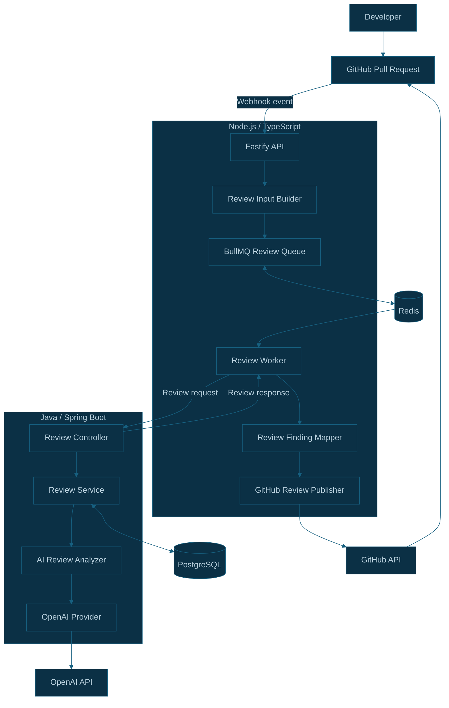

# CodeSentinel AI

> AI-powered code reviews, directly inside GitHub Pull Requests.

CodeSentinel AI is an AI-powered code review platform designed to analyze GitHub Pull Requests, identify potential bugs, security vulnerabilities, performance issues, and code-quality problems, and provide contextual recommendations directly on the Pull Request.

The platform combines a TypeScript-based Node.js API, a Java Spring Boot review service, AI-powered analysis, PostgreSQL persistence, and an asynchronous processing architecture built with BullMQ and Redis.

---

## ✨ Features

- 🤖 AI-powered Pull Request analysis
- 🔐 Security vulnerability detection
- 🐛 Bug and reliability detection
- ⚡ Performance issue detection
- 💬 Contextual inline GitHub review comments
- 📝 AI-generated Pull Request summaries
- 📊 Review history and findings
- ⚙️ Configurable review rules
- 🔄 Automatic review triggers for supported Pull Request events
- 🎯 Actionable review findings
- 🧠 Context-aware code analysis

> **Note:** Feature availability depends on the current implementation. Refer to the implementation documentation for details on completed functionality and work in progress.

---

## 🏗️ Architecture

CodeSentinel AI uses a modular architecture that separates GitHub integration, review orchestration, AI analysis, persistence, and comment publication.

### High-level architecture



**Architecture status:** This diagram represents the intended asynchronous workflow. The complete queue-to-worker-to-GitHub flow should be considered implemented only after end-to-end verification.

### Architecture components

| Component             | Technology                   | Responsibility                                                          |
| --------------------- | ---------------------------- | ----------------------------------------------------------------------- |
| GitHub integration    | GitHub App                   | Receives Pull Request events and enables repository operations          |
| API layer             | Node.js, TypeScript, Fastify | Handles webhooks, retrieves Pull Request data, and prepares review jobs |
| Background processing | BullMQ                       | Manages queued review jobs and retries                                  |
| Queue storage         | Redis                        | Stores the data used by BullMQ                                          |
| Review service        | Java 21, Spring Boot         | Orchestrates review processing and persistence                          |
| AI analysis           | OpenAI API                   | Supports AI-powered code analysis                                       |
| Database              | PostgreSQL                   | Stores review records and processing states                             |
| Review publisher      | Octokit                      | Submits valid inline review comments to GitHub                          |

### Request processing flow

1. A developer opens or updates a Pull Request.
2. GitHub sends a webhook event to the Node.js API.
3. The API validates the webhook signature and retrieves Pull Request details and changed files.
4. The API prepares a normalized review input.
5. In the target asynchronous flow, the API enqueues a job in BullMQ, backed by Redis.
6. The background worker calls the Java Spring Boot review service.
7. The Java service checks the review state and invokes AI analysis when required.
8. Review results are persisted in PostgreSQL.
9. The worker validates findings against changed lines in the Pull Request diff.
10. Valid findings are published as GitHub inline review comments.

---

## 📚 Architecture Documentation

Explore the architecture documentation for detailed diagrams, component responsibilities, processing flows, and design decisions.

| Document                                                                | Description                                                     |
| ----------------------------------------------------------------------- | --------------------------------------------------------------- |
| [System Architecture](docs/architecture/system-architecture.md)         | Overall system design, components, and responsibilities         |
| [GitHub Integration](docs/architecture/github-integration.md)           | GitHub App, webhook validation, and Pull Request retrieval      |
| [Review Processing](docs/architecture/review-processing.md)             | Node.js-to-Java review processing flow                          |
| [Asynchronous Review Queue](docs/architecture/async-review-queue.md)    | BullMQ, Redis, background jobs, and retries                     |
| [Review Lifecycle](docs/architecture/review-lifecycle.md)               | Review states and lifecycle behavior                            |
| [Persistence Lifecycle](docs/architecture/persistence-lifecycle.md)     | PostgreSQL persistence, idempotency, and failure recovery       |
| [Inline Review Comments](docs/architecture/inline-review-comments.md)   | Finding validation, line mapping, and GitHub comment submission |
| [Infrastructure](docs/architecture/infrastructure.md)                   | Local Docker infrastructure and service connectivity            |
| [Deployment Architecture](docs/architecture/deployment-architecture.md) | Local development and target deployment architecture            |

---

## 🛠️ Implementation Documentation

The implementation guides explain how individual components work in the codebase.

| Document                                                | Description                                                  |
| ------------------------------------------------------- | ------------------------------------------------------------ |
| [Review Input](docs/implementation/review-input.md)     | Review input structure and preparation                       |
| [AI Analysis](docs/implementation/ai-analysis.md)       | AI analyzer abstraction and provider integration             |
| [Redis and BullMQ](docs/implementation/redis-bullmq.md) | Queue configuration and background processing implementation |
| [Testing](docs/implementation/testing.md)               | Testing strategy and verification                            |

---

## 💻 Technology Stack

### Backend services

- Node.js
- TypeScript
- Fastify
- Java 21
- Spring Boot

### AI and background processing

- OpenAI API
- BullMQ
- Redis

### Data and integrations

- PostgreSQL
- GitHub App
- Octokit
- Docker Compose

---

## 📁 Repository Structure

```text
codesentinel-ai/
├── apps/
│   ├── api/
│   │   └── src/
│   │       ├── services/
│   │       │   ├── github/
│   │       │   └── review/
│   │       └── queues/
│   └── review-service/
│       └── src/main/java/com/codesentinel/review/
│           ├── ai/
│           ├── analyzer/
│           ├── controller/
│           ├── exception/
│           ├── review/
│           └── service/
├── dev-infrastructure/
│   ├── docker-compose.yml
│   └── data/
└── docs/
    ├── architecture/
    │   ├── system-architecture.md
    │   ├── github-integration.md
    │   ├── review-processing.md
    │   ├── async-review-queue.md
    │   ├── review-lifecycle.md
    │   ├── persistence-lifecycle.md
    │   ├── inline-review-comments.md
    │   ├── infrastructure.md
    │   └── deployment-architecture.md
    └── implementation/
        ├── review-input.md
        ├── ai-analysis.md
        ├── redis-bullmq.md
        └── testing.md
```

> This is a high-level directory overview. Consult the repository for the latest file layout.

---

## 🚀 Local Development Infrastructure

CodeSentinel AI uses Docker Compose to manage local infrastructure.

| Service    | Local port | Purpose                      |
| ---------- | ---------: | ---------------------------- |
| PostgreSQL |     `5432` | Review persistence           |
| Adminer    |     `8080` | Database administration      |
| Redis      |     `6379` | Background job queue storage |

Start the infrastructure from the `dev-infrastructure` directory:

```bash
docker compose up -d
```

Verify running services:

```bash
docker compose ps
```

Check Redis connectivity:

```bash
docker exec -it dev-redis redis-cli ping
```

For detailed setup and troubleshooting instructions, see [Infrastructure Documentation](docs/architecture/infrastructure.md).

---

## 🔒 Security Considerations

- Validate GitHub webhook signatures before processing events.
- Keep GitHub App credentials, webhook secrets, and API keys outside source control.
- Avoid logging source patches, credentials, or sensitive review payloads.
- Use appropriate access controls for database and Redis connections.
- Validate AI findings against the Pull Request diff before publishing inline comments.

---

## 🧪 Testing

CodeSentinel AI has separate Node.js and Java service test suites.

Refer to [Testing Documentation](docs/implementation/testing.md) for the test structure, commands, and verification details.

---

## 🛣️ Roadmap

Potential areas for continued development include:

- Complete and verify asynchronous review processing.
- Improve duplicate-job handling and retry safety.
- Strengthen concurrent review processing and stale-review recovery.
- Improve review observability and operational metrics.
- Add production deployment and recovery automation.
- Expand configurable review rules and analysis capabilities.

---

## 📄 License

Add the project's chosen license here when it has been selected and committed.
