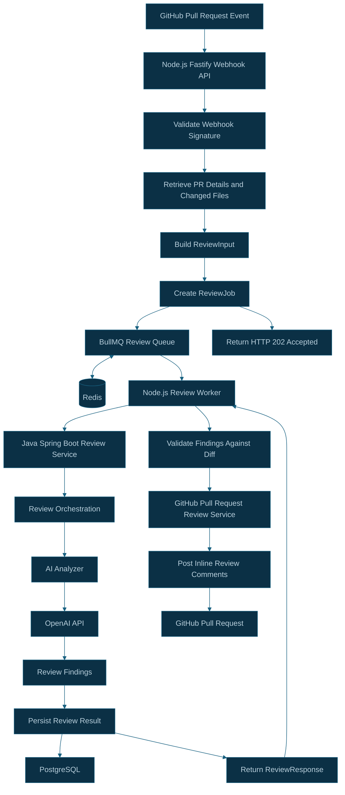

# CodeSentinel AI — Asynchronous Review Queue Architecture

## 1. Overview

CodeSentinel AI uses BullMQ and Redis to process pull request reviews asynchronously.

The Node.js Fastify API receives GitHub webhook events, validates them, retrieves pull request information, builds a review job, and adds it to a BullMQ queue.

A separate Node.js worker consumes queued jobs, calls the Java Spring Boot review service, maps the findings to GitHub inline comments, and submits the review to GitHub.

This architecture separates webhook handling from potentially slow AI review processing.

## 2. Architecture Diagram



## 3. Components and Responsibilities

| Component             | Responsibility                                                                    |
| --------------------- | --------------------------------------------------------------------------------- |
| GitHub Webhook API    | Validates webhook signatures and accepts supported pull request events            |
| Review Input Service  | Builds the normalized review input from pull request metadata and file patches    |
| Review Job            | Carries the installation ID, repository owner, repository name, and review input  |
| BullMQ Queue          | Stores jobs for background processing and manages retries                         |
| Redis                 | Provides the queue's underlying data store                                        |
| Review Worker         | Processes jobs and coordinates Java review requests and GitHub comment submission |
| Java Review Service   | Orchestrates AI review, handles review state, and persists results                |
| PostgreSQL            | Stores review records and their processing status                                 |
| GitHub Review Service | Publishes valid inline review comments                                            |

## 4. End-to-End Processing Flow

### Step 1 — Receive and validate the webhook

GitHub sends a pull request event to the Node.js Fastify API.

The API verifies the webhook signature and processes supported actions:

- `opened`
- `synchronize`
- `reopened`

Unsupported actions are ignored.

### Step 2 — Prepare the review job

The API retrieves the pull request metadata and changed files, then constructs a `ReviewInput`.

The job contains the information the worker needs to process the review independently:

- GitHub installation ID
- Repository owner
- Repository name
- Pull request metadata
- Changed file information and patches

### Step 3 — Enqueue the job

The API adds the job to the BullMQ `code-review` queue, backed by Redis.

After enqueueing succeeds, the webhook handler returns HTTP `202 Accepted`. This means the job has been accepted for processing, not that the review has completed.

If enqueueing fails, the API must not report successful acceptance of the job.

### Step 4 — Process the job

The Node.js worker consumes the queued job and calls the Java review service through:

`POST /api/v1/reviews`

The Java service validates the request, checks review state, invokes the AI analyzer when appropriate, and persists the outcome.

### Step 5 — Publish review comments

After receiving the review response, the worker maps findings to valid changed lines in the pull request diff.

The worker submits the resulting inline comments to GitHub. Findings that cannot be mapped to valid changed lines are skipped.

### Step 6 — Handle failures and retries

BullMQ is configured with three attempts and exponential backoff starting at five seconds.

Transient failures may therefore be retried automatically. The processing flow must account for the possibility that a job can run more than once.

Important considerations:

- Avoid creating duplicate queue jobs for the same repository, pull request, and head commit.
- Make review persistence idempotent.
- Prevent duplicate GitHub comments if a retry occurs after comments were submitted but before the job was marked complete.
- Log job identifiers, review status, and failure details without logging secrets or entire source patches.
- Close the worker and Redis connections during graceful shutdown.

## 5. Job and Queue Design

### Queue name

`code-review`

### Review job payload

The job should carry the following logical structure:

```ts
interface ReviewJob {
  installationId: number;
  owner: string;
  repo: string;
  reviewInput: ReviewInput;
}
```

### Default job options

The current proposed queue configuration is:

```ts
{
  attempts: 3,
  backoff: {
    type: "exponential",
    delay: 5000
  },
  removeOnComplete: 100,
  removeOnFail: 500
}
```

Completed and failed jobs are retained in limited quantities to support basic operational troubleshooting.

## 6. Reliability and Operational Considerations

### Redis availability

Redis must be available before the API can successfully enqueue jobs. The API should handle Redis connection and queue errors without acknowledging jobs that were not accepted.

### Duplicate processing

BullMQ retries and repeated webhook delivery mean that a review job may be processed more than once.

Queue deduplication and Java review idempotency are useful, but they do not by themselves guarantee exactly-once GitHub comment submission.

### Worker deployment

The worker can run as a separate Node.js process from the webhook API. This allows background review capacity to be scaled independently of incoming webhook traffic.

### Observability

Monitor:

- Waiting, active, completed, and failed jobs
- Job processing duration
- Review service failures
- Redis connectivity
- AI review failures
- GitHub comment submission failures

## 7. Related Source Files

### Node.js API

- `apps/api/src/queues/redis.ts`
- `apps/api/src/queues/reviewJob.ts`
- `apps/api/src/queues/reviewQueue.ts`
- `apps/api/src/queues/reviewWorker.ts`
- `apps/api/src/services/review/reviewInputService.ts`
- `apps/api/src/services/review/reviewServiceClient.ts`
- `apps/api/src/services/review/reviewFindingMapper.ts`
- `apps/api/src/services/github/pullRequestReviewService.ts`

### Infrastructure

- `dev-infrastructure/docker-compose.yml`

### Java Review Service

- `apps/review-service/src/main/java/com/codesentinel/review/controller/ReviewController.java`
- `apps/review-service/src/main/java/com/codesentinel/review/service/ReviewService.java`
- `apps/review-service/src/main/java/com/codesentinel/review/review/ReviewRepository.java`

## 8. Implementation Status

The following infrastructure has been set up:

- Redis runs locally in Docker.
- The Node.js API has BullMQ and ioredis installed.
- Redis connectivity has been tested.

The queue and worker files have been drafted, but the complete asynchronous flow must be verified before this architecture is considered implemented.

Remaining integration work includes:

1. Verify the queue and worker compile and start correctly.
2. Update the webhook handler to enqueue jobs instead of calling the Java service synchronously.
3. Return `202 Accepted` only after successful enqueueing.
4. Test successful reviews, retries, duplicate webhook delivery, and worker shutdown.
5. Verify that repeated processing does not create duplicate GitHub comments.

The intended result is a reliable asynchronous review pipeline with a responsive webhook API and independently scalable background workers.
