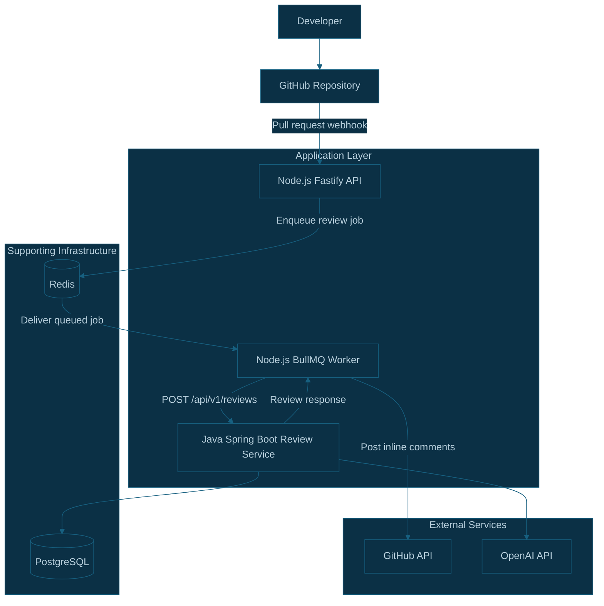
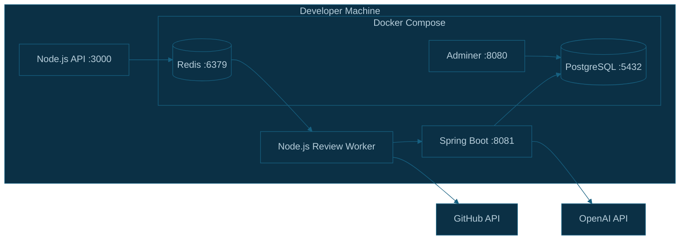

# CodeSentinel AI — Deployment and Local Development Architecture

## 1. Overview

CodeSentinel AI consists of two application services and supporting infrastructure:

- **Node.js API:** Receives GitHub webhooks, authenticates with GitHub, retrieves pull request data, and manages review jobs.
- **Node.js Review Worker:** Consumes BullMQ jobs, calls the Java review service, and publishes findings to GitHub.
- **Java Spring Boot Review Service:** Orchestrates AI-based code reviews and manages review persistence.
- **PostgreSQL:** Stores review records and processing states.
- **Redis:** Provides the data store used by BullMQ.
- **OpenAI API:** Provides AI-powered code review capabilities.

The Node.js API and worker can run as separate processes from the same codebase, allowing background processing to scale independently from webhook handling.

## 2. Deployment Architecture Diagram

## 3. Local Development Architecture

The current local development infrastructure is managed through Docker Compose in:

`dev-infrastructure/docker-compose.yml`

The Compose setup contains:

| Service    | Local port | Purpose                               |
| ---------- | ---------: | ------------------------------------- |
| PostgreSQL |     `5432` | Relational database                   |
| Adminer    |     `8080` | Browser-based database administration |
| Redis      |     `6379` | BullMQ queue storage                  |

The application services run separately during development.

| Application                    | Local address or command                                         |
| ------------------------------ | ---------------------------------------------------------------- |
| Node.js API                    | `http://127.0.0.1:3000`                                          |
| Java review service            | `http://localhost:8081`                                          |
| Node.js API development server | `npm run dev` from `apps/api`                                    |
| Node.js review worker          | `npm run worker` from `apps/api`, after the script is configured |

The worker command is an intended project script and should be verified in `apps/api/package.json` before use.

## 4. Local Infrastructure Diagram

## 5. Environment Configuration

Each service should receive its configuration through environment variables rather than hardcoded deployment-specific values.

### Node.js API and worker

Examples of configuration include:

- `REDIS_URL`
- `REVIEW_SERVICE_URL`
- GitHub App credentials
- GitHub webhook secret
- Any other environment variables required by the existing API

The API and worker must use compatible Redis and Java review-service configuration.

### Java review service

Examples include:

- PostgreSQL connection URL
- PostgreSQL username and password
- `OPENAI_API_KEY`
- Application port and any additional service configuration

Secrets must remain outside source control. Local `.env` files and credential files should be excluded from Git where appropriate.

## 6. Production Deployment Strategy

The following is a target deployment approach, not a claim that production deployment is already configured.

### Node.js API

Deploy the webhook API as a continuously available service with a publicly reachable HTTPS webhook endpoint.

### Node.js review worker

Deploy the worker as a separate process or service. Scale worker instances according to queue backlog, processing duration, and available AI-service capacity.

### Java review service

Deploy the Java service as an independently managed application. Keep it accessible to the worker through an authenticated service-to-service connection where appropriate.

### PostgreSQL and Redis

Use durable, managed infrastructure or appropriately operated database services for production. Configure backups, access controls, monitoring, and recovery procedures.

### External integrations

Configure GitHub App credentials and OpenAI credentials through a secrets manager or the deployment platform's secret-management facilities.

## 7. Networking and Security

- Expose only the endpoints that need public access.
- Keep PostgreSQL and Redis private to the services that need them.
- Use HTTPS for externally accessible endpoints.
- Validate GitHub webhook signatures before processing events.
- Avoid logging secrets, full source patches, or sensitive review payloads.
- Apply authentication and appropriate access controls to internal service endpoints.
- Configure connection limits, timeouts, health checks, and graceful shutdown behavior.

## 8. Health Checks and Observability

Monitor the health and performance of each service independently.

### Node.js API

Track webhook acceptance, validation failures, queue enqueue failures, and response latency.

### Review worker

Track waiting and active jobs, job duration, retries, failures, and comment publication failures.

### Java service

Track request latency, AI-provider errors, review-state transitions, and database failures.

### Infrastructure

Monitor PostgreSQL availability, Redis connectivity, storage, connection counts, and resource utilization.

## 9. Implementation Status

The local PostgreSQL, Adminer, and Redis Docker infrastructure has been configured.

The Node.js API and Java review service have existing local development configurations.

The asynchronous queue and worker flow is still being integrated and must be tested end to end before the deployment diagram can be considered fully implemented.

Production hosting, managed infrastructure, service authentication, and deployment automation should be configured separately before a production launch.
