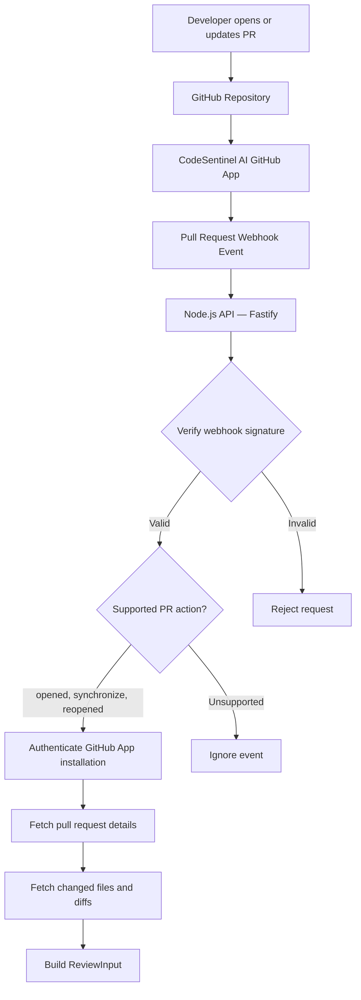

# GitHub App and Webhook Integration

## Overview

CodeSentinel AI integrates with GitHub through a GitHub App. When a pull request is opened, updated, or reopened, GitHub sends a webhook event to the Node.js API.

The API verifies the webhook signature, authenticates the GitHub App installation, retrieves pull request details and changed files, and builds a `ReviewInput` object for the code review pipeline.

## Architecture Diagram

## Processing Flow

1. A developer opens, updates, or reopens a pull request.
2. GitHub sends the corresponding webhook event to the Node.js API.
3. The API verifies the webhook signature using the configured webhook secret.
4. The API processes supported pull request actions: `opened`, `synchronize`, and `reopened`.
5. The GitHub App installation is used to authenticate API requests.
6. The pull request service retrieves the pull request metadata.
7. The service retrieves changed files and their available diff patches.
8. The review input builder converts the retrieved information into a `ReviewInput` object.
9. The review input is passed to the code review processing pipeline.

## Key Components

| Component              | Responsibility                                                 |
| ---------------------- | -------------------------------------------------------------- |
| GitHub App             | Provides repository access through installation permissions    |
| Webhook endpoint       | Receives GitHub pull request events                            |
| Signature verification | Validates the authenticity of incoming webhook payloads        |
| GitHub client          | Creates an authenticated Octokit client for an installation    |
| Pull request service   | Retrieves pull request metadata and changed files              |
| Review input builder   | Converts GitHub data into the internal `ReviewInput` structure |

## Related Source Files

- `apps/api/src/services/github/githubApp.ts`
- `apps/api/src/services/github/githubClient.ts`
- `apps/api/src/services/github/pullRequestService.ts`
- `apps/api/src/services/review/reviewInputService.ts`
- GitHub webhook controller under `apps/api/src/`

Verify the exact webhook controller filename against the repository.

## Implementation Status

**Implemented:** GitHub App integration, webhook signature verification, supported pull request event handling, pull request retrieval, changed-file retrieval, and review input construction.

**Next:** Document the Node.js-to-Java review request and response flow in `docs/architecture/review-processing.md`.

The BullMQ queue handoff is a separate implementation step and should be documented as complete only after the webhook enqueues jobs and the worker processes them successfully.
