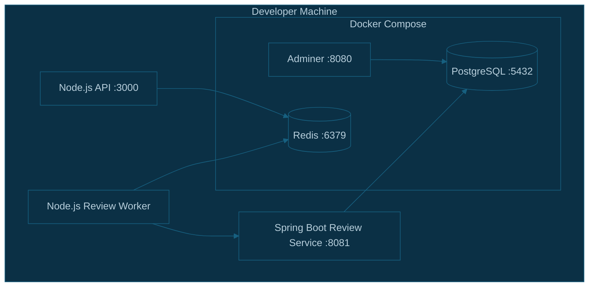

# CodeSentinel AI — Infrastructure Architecture

## 1. Overview

CodeSentinel AI uses reusable local infrastructure to support development and testing.

The infrastructure is maintained separately from the application source code:

`/Users/tejasmudholkar/Developer/dev-infrastructure/`

Docker Compose manages three services:

- PostgreSQL for relational data storage.
- Adminer for browser-based database administration.
- Redis for BullMQ background job processing.

The Node.js API, Node.js review worker, and Java Spring Boot review service run separately during local development and connect to these infrastructure services through their configured endpoints.

## 2. Infrastructure Architecture



## 3. Infrastructure Directory Structure

```text
dev-infrastructure/
├── docker-compose.yml
├── .env
├── .gitignore
└── data/
    ├── postgres/
    └── redis/
```

### File and directory responsibilities

| Path                 | Responsibility                                            |
| -------------------- | --------------------------------------------------------- |
| `docker-compose.yml` | Defines PostgreSQL, Adminer, and Redis services           |
| `.env`               | Supplies local infrastructure configuration               |
| `.gitignore`         | Excludes local environment secrets and data directories   |
| `data/postgres/`     | Stores persistent PostgreSQL data                         |
| `data/redis/`        | Stores Redis data used by the configured persistence mode |

The `data` directories contain runtime data and must not be committed to Git.

**Important:** Do not delete `data/postgres/` as part of routine cleanup. It contains persistent database data that may be needed by other local projects.

## 4. Docker Compose Services

### 4.1 PostgreSQL

PostgreSQL provides relational persistence for CodeSentinel AI and other local development projects.

| Setting            | Value             |
| ------------------ | ----------------- |
| Image              | `postgres:17`     |
| Container name     | `dev-postgres`    |
| Host port          | `5432`            |
| Persistent storage | `./data/postgres` |

The database name, username, and password are configured through environment variables.

The Java review service uses its own configured database, `codesentinel_db`, on the local PostgreSQL instance. Other databases, such as `tejasDB`, may also exist on that instance.

Do not assume that all projects use the same database.

### 4.2 Adminer

Adminer provides a browser-based interface for inspecting and administering PostgreSQL.

| Setting        | Value            |
| -------------- | ---------------- |
| Image          | `adminer:latest` |
| Container name | `dev-adminer`    |
| Host port      | `8080`           |

Local address:

`http://localhost:8080`

Select PostgreSQL as the database system and enter the appropriate database server and credentials.

For the Compose network, the PostgreSQL service hostname is `postgres`. From a browser on the host machine, use the local PostgreSQL endpoint instead.

### 4.3 Redis

Redis provides the data store used by BullMQ.

| Setting        | Value                          |
| -------------- | ------------------------------ |
| Image          | `redis:7-alpine`               |
| Container name | `dev-redis`                    |
| Host port      | `6379`                         |
| Persistence    | Redis append-only file enabled |

The local Node.js API and worker can connect using:

`redis://localhost:6379`

This URL assumes Redis is reachable on the default local port and that no additional authentication has been configured.

The Compose configuration uses a mounted data directory at `./data/redis`.

## 5. Environment Configuration

The infrastructure `.env` file supplies configuration values to Docker Compose.

Typical variables include:

- `POSTGRES_DB`
- `POSTGRES_USER`
- `POSTGRES_PASSWORD`
- `REDIS_URL`

The actual environment variable names used by each application must match its configuration code.

### Application configuration

The infrastructure `.env` file is not automatically loaded by an independently launched Node.js or Java application.

Configure the applications separately.

For the Node.js API and worker, ensure the API environment includes the Redis connection URL and the Java review-service URL.

For the Java service, configure the PostgreSQL connection URL, username, password, and OpenAI API key.

Keep secrets out of source control. Use local environment files for development and an appropriate secret-management mechanism for production.

## 6. Starting and Managing Infrastructure

Run these commands from the infrastructure directory:

```bash
cd /Users/tejasmudholkar/Developer/dev-infrastructure
```

### Start all services

```bash
docker compose up -d
```

### View running containers

```bash
docker compose ps
```

### View service logs

```bash
docker compose logs -f postgres
docker compose logs -f redis
docker compose logs -f adminer
```

### Stop services

```bash
docker compose stop
```

### Start stopped services

```bash
docker compose start
```

### Stop and remove containers

```bash
docker compose down
```

The standard `docker compose down` command removes the containers and network but does not remove the bind-mounted data directories.

**Never use `docker compose down -v` or delete the persistent data directories without first understanding the data-loss implications.**

## 7. Verifying PostgreSQL and Redis

### Verify PostgreSQL

Check that the container is running:

```bash
docker compose ps postgres
```

Connect to PostgreSQL inside the container:

```bash
docker exec -it dev-postgres psql -U tejas -d tejasDB
```

Use the appropriate database and username for the project you want to inspect.

Inside `psql`, useful commands include:

```sql
\l
\dt
SELECT current_database();
```

Exit with:

```sql
\q
```

### Verify Redis

Check Redis connectivity:

```bash
docker exec -it dev-redis redis-cli ping
```

A healthy Redis instance should return:

```text
PONG
```

This verifies basic Redis connectivity. It does not verify that BullMQ jobs are being enqueued and processed successfully.

## 8. Application Connectivity

| Application | Infrastructure
