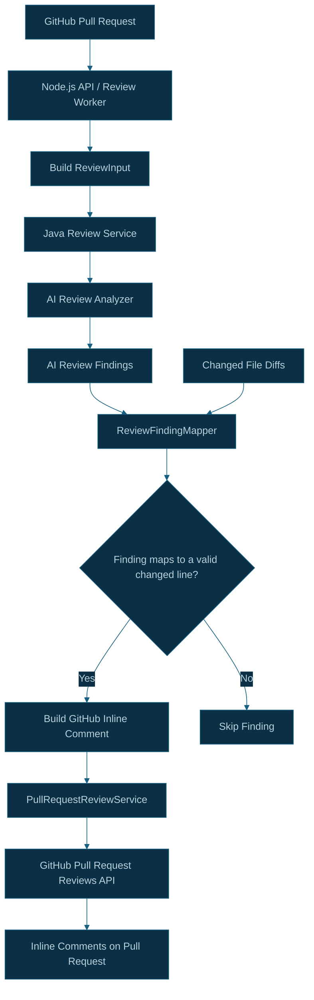
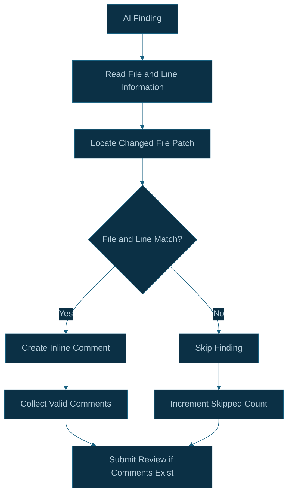

# CodeSentinel AI — Inline Review Comments Architecture

## 1. Overview

CodeSentinel AI converts AI-generated review findings into inline comments on GitHub pull requests.

The Java Spring Boot review service analyzes the submitted pull request input and returns review findings. The Node.js API or background worker then uses `ReviewFindingMapper` to map those findings to GitHub's pull request review comment format.

Before publishing comments, the mapper validates that the finding's line corresponds to a valid changed line in the pull request diff.

The GitHub review service submits the valid comments through the GitHub Pull Request Reviews API.

## 2. Architecture Diagram



## 3. End-to-End Comment Flow

### Step 1 — Generate AI review findings

The Java review service receives the normalized pull request input and invokes the configured review analyzer.

The service returns a `ReviewResponse` containing the review outcome and findings exposed by the response DTO.

Each finding may contain information such as the file and line associated with an issue, along with its description and other review metadata supported by the DTO.

### Step 2 — Match findings against changed files

The Node.js `ReviewFindingMapper` receives:

- The review findings from the Java service.
- The changed files from the original review input.

The mapper uses the changed-file patches to determine whether each finding can be placed on a valid changed line.

A finding that cannot be mapped to a valid changed line is skipped rather than submitted as an invalid inline comment.

### Step 3 — Build GitHub review comments

For each valid finding, the mapper constructs a comment in the format expected by the GitHub pull request review API.

The mapping process must preserve the relationship between the finding and the relevant file and changed line.

The current implementation uses the `RIGHT` side for mapped inline comments.

### Step 4 — Submit the review

`PullRequestReviewService` submits the mapped comments using the GitHub Pull Request Reviews API.

The review submission includes:

- GitHub installation ID
- Repository owner and name
- Pull request number
- Commit SHA
- Review summary body
- Valid inline review comments

The review event is `COMMENT`.

If no valid comments remain after mapping, the current worker flow does not submit a GitHub review.

### Step 5 — Record processing metrics

The worker logs review-processing metrics, including:

- Pull request number
- Number of findings returned
- Number of comments posted
- Number of findings skipped because they could not be mapped

The logs should not contain complete source patches, credentials, or entire review payloads.

## 4. Diff-Line Validation

GitHub inline review comments must reference lines that can be commented on in the pull request diff.

AI-generated line numbers cannot be assumed to be valid simply because they refer to a line in the complete source file.

The mapper therefore validates findings against the changed lines available in the pull request patches.



### Why validation matters

Diff-line validation helps avoid:

- Comments against unchanged lines.
- Comments against files that are not part of the review input.
- Invalid line references that GitHub may reject.
- Publishing findings that cannot be reliably connected to the proposed code changes.

A skipped finding is not necessarily an incorrect AI finding. It may simply be impossible to place as a valid inline comment under the current mapping rules.

## 5. GitHub Review Submission

The GitHub review publisher uses the Octokit GitHub API client to submit a pull request review.

Conceptually, the request contains:

```ts
{
  commitId: reviewInput.pullRequest.headSha,
  body: "CodeSentinel AI review summary",
  comments: [
    // Validated inline comments
  ]
}
```

This is an illustrative representation of the submission data, not the complete implementation signature.

The commit SHA associates the review with the head commit that was analyzed.

## 6. Error Handling and Retry Considerations

Comment publication is an external operation and can fail independently of AI analysis or database persistence.

Potential failure scenarios include:

- GitHub API rate limits.
- Expired or invalid GitHub credentials.
- Insufficient repository permissions.
- Invalid comment positions.
- Network timeouts.
- The pull request head changing while a review is being processed.

The worker should surface these failures through structured logs and its job-failure handling so that retry behavior can be evaluated.

### Duplicate comments during retries

A worker may successfully submit comments to GitHub but fail before BullMQ records the job as completed.

If the job is retried, the comments could be submitted again.

Queue deduplication and database idempotency do not independently guarantee exactly-once comment publication.

A future improvement is to track comment publication state or implement a reliable reconciliation strategy for repeated submissions.

## 7. Security Considerations

- Use GitHub App installation authentication rather than embedding personal access tokens in source code.
- Keep GitHub App credentials and webhook secrets outside source control.
- Do not log full source patches or sensitive review payloads.
- Validate the repository, pull request, and commit context before publishing comments.
- Limit the GitHub App permissions to the capabilities the application requires.

## 8. Related Source Files

### Node.js API

- `apps/api/src/services/review/reviewFindingMapper.ts`
- `apps/api/src/services/review/reviewInputService.ts`
- `apps/api/src/services/review/reviewServiceClient.ts`
- `apps/api/src/services/github/pullRequestReviewService.ts`
- `apps/api/src/services/github/githubClient.ts`
- `apps/api/src/queues/reviewWorker.ts`

The worker path applies once the asynchronous worker integration is complete and verified.

## 9. Implementation Status

The finding mapper, changed-line validation, GitHub review submission service, and basic processing metrics have been implemented.

The full asynchronous publication flow remains subject to end-to-end verification.

Important future improvements include retry-safe comment publication, handling pull request updates during review processing, and stronger reconciliation of partial failures.
