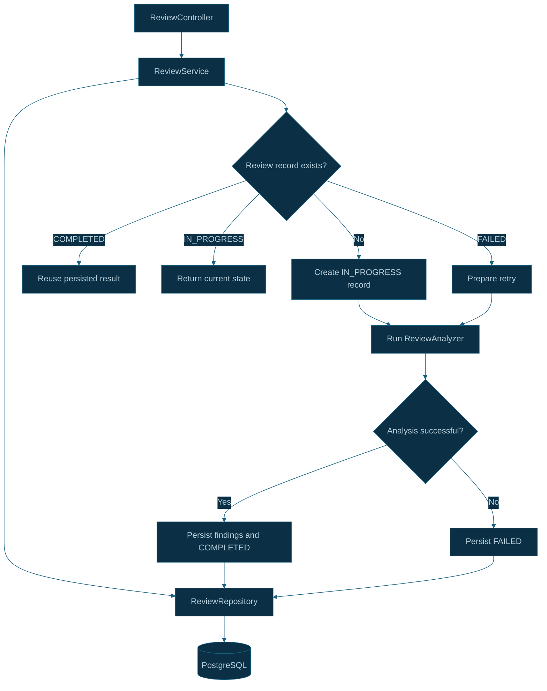
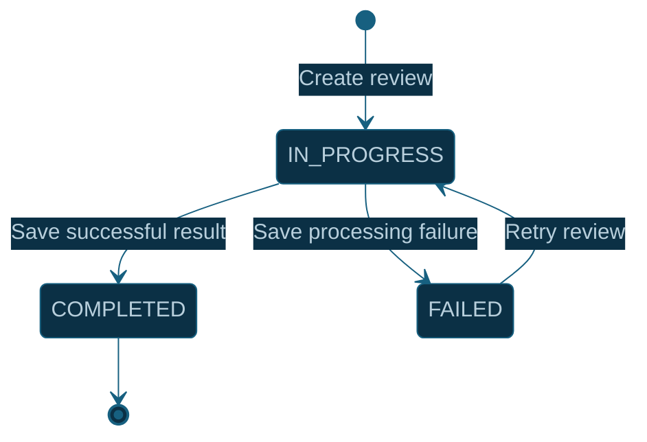
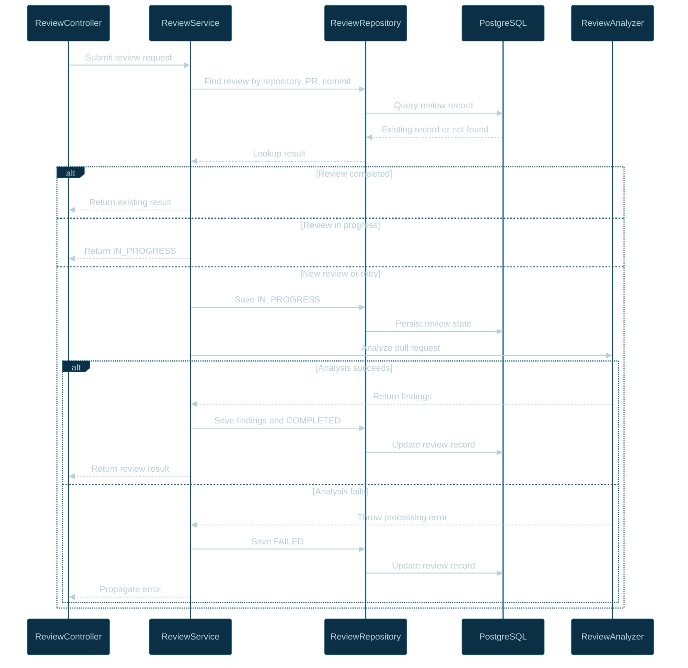

# CodeSentinel AI — Persistence Lifecycle

## 1. Overview

CodeSentinel AI uses PostgreSQL to persist code review records and track the processing state of each review.

The Java Spring Boot review service coordinates persistence through `ReviewService` and `ReviewRepository`. The database provides durable storage for review records and enforces uniqueness for a particular repository, pull request, and commit.

Persistence supports three primary review states:

- `IN_PROGRESS`
- `COMPLETED`
- `FAILED`

The persistence lifecycle helps prevent unnecessary repeated AI analysis and provides a record of review processing outcomes.

## 2. Persistence Architecture



## 3. Review Record Identity

A review record is identified by the combination of:

```text
repository + pull_request_number + commit_sha
```

This identity distinguishes reviews of different commits within the same pull request.

For example:

| Repository   | PR number | Commit SHA | Interpretation                     |
| ------------ | --------: | ---------- | ---------------------------------- |
| `owner/repo` |        15 | `abc123`   | Review for the first commit        |
| `owner/repo` |        15 | `def456`   | Separate review for a newer commit |
| `owner/repo` |        16 | `abc123`   | Separate pull request              |

The database's unique constraint protects against storing multiple review records with the same identity.

## 4. Persistence Lifecycle



### `IN_PROGRESS`

The service creates or updates a review record before executing the analyzer.

This state indicates that the review has started but has not yet reached a final outcome.

### `COMPLETED`

The service stores the successful review outcome and marks the record as completed.

A subsequent request for the same review identity can reuse the persisted result instead of repeating AI analysis.

### `FAILED`

If review processing throws a runtime exception, the service records the failed state and propagates the exception.

A later request can retry the review.

## 5. Database Interaction Sequence



## 6. Idempotency Behavior

The persistence layer supports basic idempotency for repeated requests.

| Request condition                                       | Expected behavior                   |
| ------------------------------------------------------- | ----------------------------------- |
| Same repository, PR, and commit with a completed review | Reuse the existing result           |
| Same identity with an in-progress review                | Return the current processing state |
| Same identity with a failed review                      | Retry processing                    |
| Same PR with a different commit SHA                     | Create a separate review record     |

This behavior reduces unnecessary AI calls for ordinary duplicate requests.

However, the existence check and subsequent insert are separate operations. Two simultaneous requests may both initially observe that a record does not exist.

The unique constraint protects database integrity, but application-level conflict handling is still needed to handle this race cleanly.

## 7. Transaction and Failure Considerations

Persistence and external AI calls have different failure characteristics.

### Database failures

A failed database write can prevent the review from being created, updated, or completed. These failures must be surfaced rather than silently ignored.

### AI failures

The current service attempts to persist `FAILED` when analysis throws a runtime exception and then propagates the original failure.

If saving the failure state also fails, the database may not reflect the actual processing outcome. This scenario requires appropriate error logging and recovery handling.

### Process interruption

If the process terminates after creating an `IN_PROGRESS` record but before completing the review, the record may remain in progress.

A recovery strategy should identify stale records and determine whether to retry them safely.

### External comment publication

Persisting a review result is separate from publishing GitHub comments. A database transaction cannot atomically commit a PostgreSQL update and a GitHub API operation.

The asynchronous worker must therefore account for retries and partial success when publishing comments.

## 8. Recommended Improvements

The following are potential improvements rather than claims about the current implementation.

1. **Concurrent review protection:** Use atomic database operations, locking, or another concurrency-control strategy to prevent overlapping processing.
2. **Stale-review recovery:** Detect reviews that remain `IN_PROGRESS` beyond a configured threshold.
3. **Retry safety:** Make retries safe when AI analysis or comment publication partially succeeds.
4. **Persistence observability:** Record review identifiers, state transitions, and error details without logging secrets or source patches.
5. **Schema management:** Consider controlled database migrations instead of relying indefinitely on automatic schema updates.
6. **Retention policy:** Define how long review records and associated findings should be retained.

## 9. Related Source Files

### Java review service

- `apps/review-service/src/main/java/com/codesentinel/review/review/Review.java`
- `apps/review-service/src/main/java/com/codesentinel/review/review/ReviewRepository.java`
- `apps/review-service/src/main/java/com/codesentinel/review/review/ReviewStatus.java`
- `apps/review-service/src/main/java/com/codesentinel/review/service/ReviewService.java`
- `apps/review-service/src/main/java/com/codesentinel/review/controller/ReviewController.java`

## 10. Implementation Status

The review entity, repository, review states, unique identity constraint, and basic duplicate-request handling have been implemented.

Additional work remains for concurrent request handling, stale `IN_PROGRESS` recovery, and retry-safe coordination with GitHub comment publication.

These are important reliability improvements as CodeSentinel AI transitions to asynchronous processing through BullMQ.
