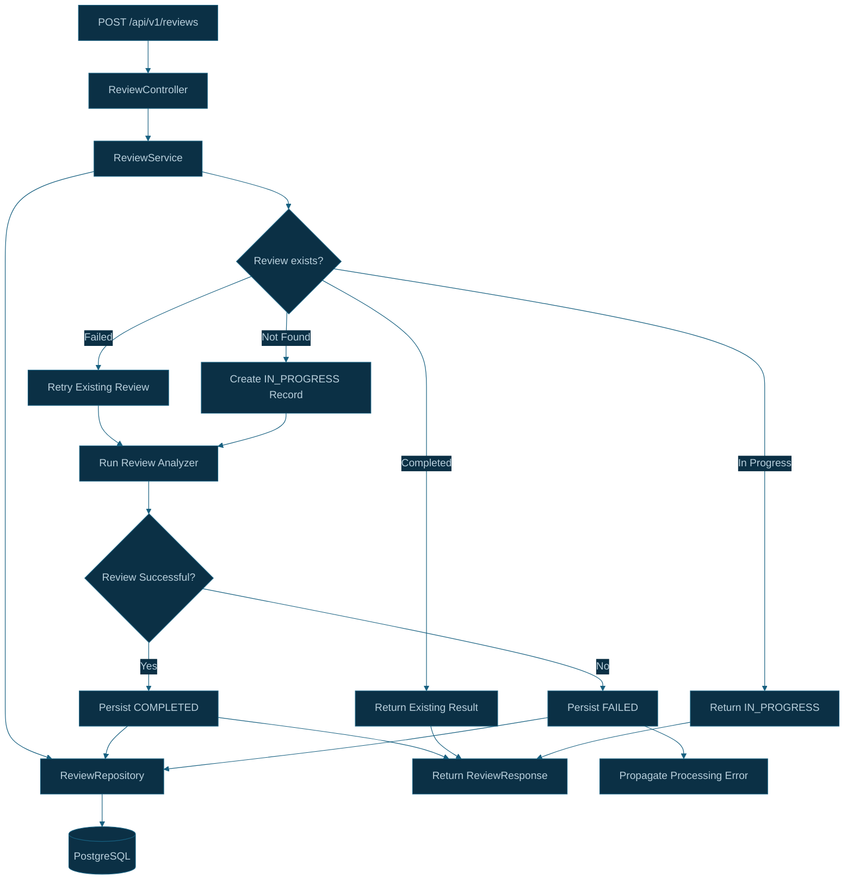
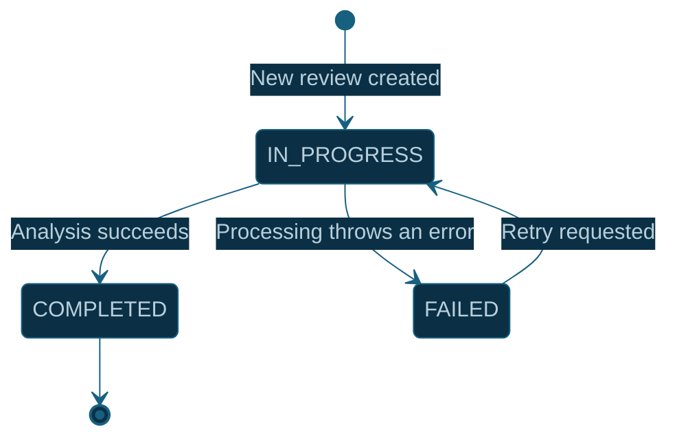

# CodeSentinel AI — Database and Review Lifecycle Architecture

## 1. Overview

CodeSentinel AI uses PostgreSQL to persist pull request review records and track their processing lifecycle.

The Java Spring Boot review service coordinates review processing through `ReviewService` and accesses stored records through `ReviewRepository`.

A review is identified by the combination of:

- Repository
- Pull request number
- Commit SHA

This allows repeated requests for the same commit to reuse completed review results rather than rerunning AI analysis unnecessarily.

## 2. Architecture Diagram



## 3. Review Lifecycle



A new review begins in `IN_PROGRESS`.

When the analysis succeeds, the service persists the completed result. When processing throws a runtime exception, the service records `FAILED` and propagates the exception.

A failed review can be retried. A completed review is reused for subsequent requests with the same repository, pull request number, and commit SHA.

## 4. Review Identity and Database Constraint

The review entity has a unique constraint on:

```text
repository + pull_request_number + commit_sha
```

Conceptually, this is the identity of one review for a particular pull request commit.

For example, a new commit pushed to the same pull request has a different commit SHA and therefore represents a distinct review.

The database constraint is important because application-level existence checks alone cannot prevent all duplicate records when requests arrive concurrently.

## 5. Review State Behavior

| Current condition                       | Service behavior                                  |
| --------------------------------------- | ------------------------------------------------- |
| No matching review                      | Create an `IN_PROGRESS` record and start analysis |
| `IN_PROGRESS`                           | Return an `IN_PROGRESS` response                  |
| `COMPLETED`                             | Reuse the stored review result                    |
| `FAILED`                                | Mark the review as in progress and retry analysis |
| Analysis succeeds                       | Persist `COMPLETED`                               |
| Analysis fails with a runtime exception | Persist `FAILED` and propagate the error          |

## 6. Processing Sequence

### Step 1 — Receive a review request

`ReviewController` receives the request at:

`POST /api/v1/reviews`

It validates the request and delegates processing to `ReviewService`.

### Step 2 — Check for an existing review

`ReviewService` queries `ReviewRepository` using the repository name, pull request number, and commit SHA.

If a completed review exists, the service avoids rerunning AI analysis.

If the record is in progress, the service returns the current state. If the record has failed, it initiates a retry.

### Step 3 — Execute the analyzer

For a new review or a retry, the service runs the configured review analyzer.

The analyzer returns findings that are incorporated into the persisted review result.

### Step 4 — Persist the final state

On success, the service stores the review result with status `COMPLETED`.

On a runtime failure, the service marks the record `FAILED`, saves that state, and rethrows the exception.

### Step 5 — Return the response

The service returns the resulting review response to the Node.js API, which can subsequently map findings to GitHub inline comments.

## 7. Concurrency and Idempotency Considerations

### Unique constraint violations

Two requests for the same review can arrive at almost the same time. Both may initially find no existing record, causing one insert to fail against the unique constraint.

The unique constraint protects database integrity, but the service still needs explicit handling for this race condition.

### Concurrent retries

The current state-checking flow should not be treated as a complete concurrency-control mechanism. Concurrent requests may attempt to process the same failed review or overlap with an existing review.

A future improvement is to use atomic database operations or locking to claim a review before starting analysis.

### Review results versus GitHub comments

Persisting a completed review and posting GitHub comments are separate operations.

If a worker retries after comments have already been posted, the GitHub review may be submitted again unless comment publication is also made idempotent.

Database idempotency alone does not guarantee exactly-once comment submission.

## 8. Related Source Files

### Java Review Service

- `apps/review-service/src/main/java/com/codesentinel/review/service/ReviewService.java`
- `apps/review-service/src/main/java/com/codesentinel/review/review/Review.java`
- `apps/review-service/src/main/java/com/codesentinel/review/review/ReviewRepository.java`
- `apps/review-service/src/main/java/com/codesentinel/review/review/ReviewStatus.java`
- `apps/review-service/src/main/java/com/codesentinel/review/controller/ReviewController.java`

## 9. Implementation Status

The review entity, repository, lifecycle statuses, and basic duplicate-request handling have been implemented and tested.

The following remain important improvements:

1. Handle unique-constraint violations caused by concurrent review requests.
2. Prevent overlapping processing of the same review.
3. Add robust retry and recovery behavior for reviews left in `IN_PROGRESS` after an unexpected process shutdown.
4. Coordinate review completion with GitHub comment publication so retries do not duplicate comments.

These improvements become particularly important once the BullMQ worker processes jobs asynchronously.
