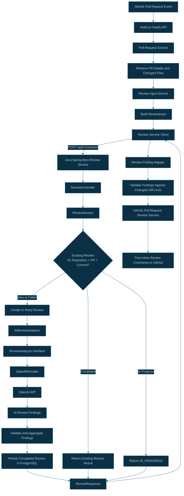

# CodeSentinel AI — Review Processing Architecture

## 1. Overview

CodeSentinel AI uses a Node.js API and a Java Spring Boot review service to analyze GitHub pull requests.

The Node.js API is responsible for preparing pull request data and communicating with GitHub. The Java service handles review orchestration, AI analysis, finding aggregation, and persistence.

OpenAI is accessed through the Java service's AI provider abstraction.

## 2. Architecture Diagram

## 3. Processing Flow

### Step 1 — Prepare the pull request input

The Node.js API retrieves pull request metadata and changed files from GitHub.

The review input contains:

- Repository name
- Pull request number and title
- Pull request description
- Base and head branches
- Head commit SHA
- Pull request URL
- Changed file names, statuses, additions, deletions, changes, and patches

The `ReviewInputService` builds the input object and filters out files that do not contain a patch.

### Step 2 — Call the Java review service

The Node.js `ReviewServiceClient` sends the prepared input to:

`POST /api/v1/reviews`

The Java `ReviewController` validates the request and delegates review processing to `ReviewService`.

### Step 3 — Apply idempotency and review-state handling

The Java service uses PostgreSQL to track reviews by repository, pull request number, and commit SHA.

| Existing state     | Behavior                                                        |
| ------------------ | --------------------------------------------------------------- |
| Completed          | Return the existing review result without rerunning AI analysis |
| In progress        | Return an `IN_PROGRESS` response                                |
| Failed             | Retry the review                                                |
| No existing review | Create a new review record and start processing                 |

This prevents normal repeated requests for the same commit from unnecessarily rerunning a completed review. Concurrent requests still require additional race-condition handling.

### Step 4 — Analyze the code with AI

The `ReviewService` invokes `AIReviewAnalyzer`, which uses the `ReviewAnalyzer` abstraction.

The AI analyzer calls the configured `OpenAIProvider`, which communicates with the OpenAI API and returns review findings.

The Java service processes the findings and persists the review outcome in PostgreSQL.

Review failures are recorded using the `FAILED` status before the exception is propagated.

### Step 5 — Return the review response

The Java service returns a `ReviewResponse` containing the review status and review metrics or findings exposed by the response DTO.

The Node.js API receives this response and passes the findings to `ReviewFindingMapper`.

### Step 6 — Map findings to GitHub comments

Before posting inline comments, the Node.js mapper checks whether each finding maps to a valid changed line in the pull request diff.

Findings that cannot be mapped to valid changed lines are skipped.

If valid comments remain, `PullRequestReviewService` submits them to GitHub using the pull request review API.

## 4. Component Responsibilities

| Component                  | Responsibility                                   |
| -------------------------- | ------------------------------------------------ |
| `ReviewInputService`       | Builds the normalized pull request review input  |
| `ReviewServiceClient`      | Sends review requests to the Java service        |
| `ReviewController`         | Exposes the review REST endpoint                 |
| `ReviewService`            | Orchestrates review processing and persistence   |
| `AIReviewAnalyzer`         | Implements AI-based code review                  |
| `ReviewAnalyzer`           | Defines the review analyzer abstraction          |
| `OpenAIProvider`           | Integrates with the OpenAI API                   |
| `ReviewRepository`         | Persists and retrieves review records            |
| `ReviewFindingMapper`      | Maps AI findings to valid GitHub inline comments |
| `PullRequestReviewService` | Posts the review comments to GitHub              |

## 5. Related Source Files

### Node.js API

- `apps/api/src/services/review/reviewInputService.ts`
- `apps/api/src/services/review/reviewServiceClient.ts`
- `apps/api/src/services/review/reviewFindingMapper.ts`
- `apps/api/src/services/github/pullRequestService.ts`
- `apps/api/src/services/github/pullRequestReviewService.ts`

### Java Review Service

- `apps/review-service/src/main/java/com/codesentinel/review/controller/ReviewController.java`
- `apps/review-service/src/main/java/com/codesentinel/review/service/ReviewService.java`
- `apps/review-service/src/main/java/com/codesentinel/review/analyzer/AIReviewAnalyzer.java`
- `apps/review-service/src/main/java/com/codesentinel/review/analyzer/ReviewAnalyzer.java`
- `apps/review-service/src/main/java/com/codesentinel/review/ai/OpenAIProvider.java`
- `apps/review-service/src/main/java/com/codesentinel/review/review/ReviewRepository.java`

## 6. Current Status and Next Step

The existing processing path is synchronous: the Node.js webhook flow waits for the Java review service before it can post the resulting GitHub comments.

Redis and BullMQ are being introduced to move review processing into a background worker. Once integrated, the webhook will enqueue a review job and return an accepted response instead of waiting for the full AI review.

The asynchronous queue and worker flow will be documented separately so the current implementation is not confused with the target architecture.
