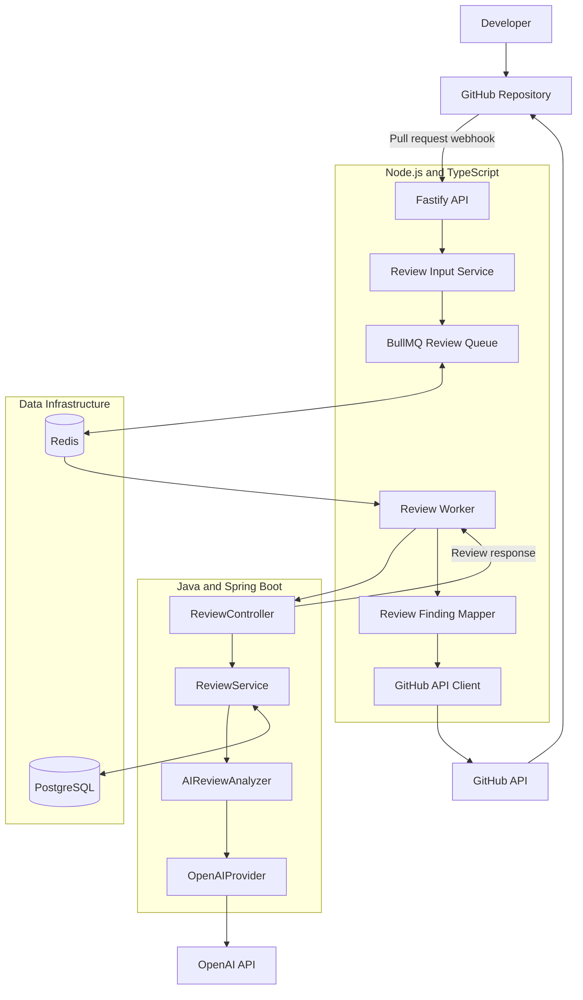

# CodeSentinel AI — System Architecture

## 1. Overview

CodeSentinel AI is an AI-powered code review platform designed to analyze GitHub pull requests and publish actionable review comments.

The system integrates with GitHub through a GitHub App, uses a Node.js API for webhook handling and GitHub operations, and delegates review analysis to a Java Spring Boot service.

The Java service uses an analyzer abstraction to integrate AI-powered review capabilities through OpenAI. PostgreSQL stores review records and processing states, while Redis and BullMQ provide the infrastructure for asynchronous review processing.

The system is organized into the following major components:

- GitHub integration
- Node.js API
- BullMQ review queue and worker
- Java Spring Boot review service
- AI review provider
- PostgreSQL persistence
- Redis infrastructure

## 2. High-Level Architecture



**Architecture status:** The diagram represents the intended architecture, including the asynchronous BullMQ flow. Redis infrastructure is configured locally, but the complete queue-to-worker-to-GitHub flow must be verified before it is considered fully implemented.

## 3. Component Responsibilities

### 3.1 GitHub App

The GitHub App connects CodeSentinel AI to repositories and pull requests.

Responsibilities:

- Receive pull request webhook events.
- Authenticate GitHub API operations using the app installation.
- Retrieve pull request metadata and changed files.
- Publish review comments on pull requests.

The Node.js API verifies webhook signatures before processing supported events.

Supported pull request actions include:

- `opened`
- `synchronize`
- `reopened`

### 3.2 Node.js Fastify API

The API is responsible for webhook handling and coordination with GitHub.

Responsibilities:

- Accept GitHub webhook requests.
- Verify webhook signatures.
- Filter supported pull request events.
- Retrieve pull request metadata and changed files.
- Build a normalized `ReviewInput`.
- Enqueue review jobs when asynchronous processing is integrated.

The API is implemented in TypeScript and uses Fastify.

### 3.3 Review Input Service

The review input service prepares the data sent to the Java review service.

The input includes:

- Repository name
- Pull request number
- Title and description
- Base and head branches
- Head commit SHA
- Pull request URL
- Changed file metadata and patches

Files without a patch are filtered out by the current input-building logic.

### 3.4 BullMQ Queue and Redis

BullMQ and Redis are intended to separate webhook handling from AI review execution.

Responsibilities:

- Queue pull request review jobs.
- Deliver jobs to background workers.
- Retry failed jobs according to queue configuration.
- Retain a limited number of completed and failed jobs for troubleshooting.

The queue is named `code-review`.

The proposed configuration uses three attempts with exponential backoff starting at five seconds.

### 3.5 Node.js Review Worker

The worker consumes review jobs from BullMQ.

Responsibilities:

- Read the queued review input and GitHub installation details.
- Call the Java review service.
- Receive the review response.
- Map findings to valid changed lines in the pull request diff.
- Submit valid inline review comments to GitHub.
- Log processing metrics and failures.

The worker can run separately from the API process, allowing background review processing to scale independently.

### 3.6 Java Spring Boot Review Service

The Java service owns the review-processing domain.

Its main responsibilities are:

- Validate review requests.
- Coordinate the review lifecycle.
- Check for existing reviews.
- Invoke the configured analyzer.
- Persist review records and results.
- Return the review response.

The REST endpoint is:

`POST /api/v1/reviews`

The local development port is `8081`.

### 3.7 AI Review Analyzer and Provider

The AI review flow uses an analyzer abstraction.

- `ReviewAnalyzer` defines the analyzer contract.
- `AIReviewAnalyzer` implements AI-powered code review.
- `AIProvider` abstracts the AI provider integration.
- `OpenAIProvider` communicates with the OpenAI API.

This separation keeps the review orchestration independent of the specific AI provider implementation.

### 3.8 PostgreSQL

PostgreSQL stores review records and processing state.

The review identity uses:

`repository + pull_request_number + commit_sha`

The review lifecycle uses these states:

- `IN_PROGRESS`
- `COMPLETED`
- `FAILED`

A completed review can be reused for repeated requests for the same review identity, avoiding unnecessary AI analysis.

### 3.9 GitHub Review Publisher

The GitHub review publisher submits inline comments after the worker receives the Java review response.

Before posting comments, the finding mapper validates that the reported lines correspond to changed lines in the pull request diff.

Findings that cannot be mapped to valid changed lines are skipped.

## 4. End-to-End Request Flow

1. A developer opens or updates a pull request.
2. GitHub sends a webhook event to the Node.js API.
3. The API validates the webhook signature and checks the event action.
4. The API retrieves pull request details and changed files.
5. The Review Input Service builds a normalized review input.
6. The API enqueues a review job in BullMQ when asynchronous processing is enabled.
7. The worker consumes the job and calls the Java review service.
8. The Java service checks the review state and invokes AI analysis when required.
9. The Java service persists the review result in PostgreSQL.
10. The Java service returns the review response to the worker.
11. The worker maps findings to valid changed lines.
12. The worker submits inline review comments to GitHub.

In the intended asynchronous flow, the webhook handler returns HTTP `202 Accepted` after successful enqueueing rather than waiting for the complete review.

## 5. Technology Stack

| Area                             | Technology              |
| -------------------------------- | ----------------------- |
| Source control and pull requests | GitHub                  |
| GitHub integration               | GitHub App              |
| API runtime                      | Node.js                 |
| API framework                    | Fastify                 |
| API language                     | TypeScript              |
| Background jobs                  | BullMQ                  |
| Queue data store                 | Redis                   |
| Review service                   | Java 21 and Spring Boot |
| Persistence                      | PostgreSQL              |
| AI integration                   | OpenAI API              |
| Local infrastructure             | Docker Compose          |
| Database administration          | Adminer                 |

## 6. Repository Organization

```text
codesentinel-ai/
├── apps/
│   ├── api/
│   │   └── src/
│   │       ├── services/
│   │       │   ├── github/
│   │       │   └── review/
│   │       └── queues/
│   └── review-service/
│       └── src/main/java/com/codesentinel/review/
│           ├── ai/
│           ├── analyzer/
│           ├── controller/
│           ├── exception/
│           ├── review/
│           └── service/
├── dev-infrastructure/
│   ├── docker-compose.yml
│   └── data/
└── docs/
    ├── architecture/
    └── implementation/
```

The directory structure above is a high-level representation; individual files may change as the project evolves.

## 7. Local Development Services

The reusable Docker Compose infrastructure provides:

| Service    |   Port | Purpose                 |
| ---------- | -----: | ----------------------- |
| PostgreSQL | `5432` | Database                |
| Adminer    | `8080` | Database administration |
| Redis      | `6379` | BullMQ queue storage    |

The application services run separately during local development:

- Node.js API: port `3000`
- Java review service: port `8081`
- Node.js worker: separate process using the API codebase

## 8. Reliability and Security Principles

- Verify GitHub webhook signatures before processing events.
- Keep API credentials and secrets out of source control.
- Avoid logging source patches, sensitive review payloads, or credentials.
- Use database constraints to protect review-record uniqueness.
- Treat queue jobs as potentially repeatable.
- Make GitHub comment publication resilient to retries.
- Handle Redis, AI provider, database, and GitHub API failures explicitly.
- Use graceful shutdown for background workers and Redis connections.
- Keep PostgreSQL and Redis private to trusted application services in production.

## 9. Current Implementation Status

### Implemented or configured

- GitHub App integration and webhook signature verification.
- Pull request retrieval and review input construction.
- Java Spring Boot review endpoint and AI review components.
- PostgreSQL review persistence and basic idempotency.
- Local Docker infrastructure for PostgreSQL, Adminer, and Redis.
- BullMQ and ioredis package installation.

### Requires further integration or verification

- Complete BullMQ queue and worker integration.
- Webhook handoff to the queue and HTTP `202 Accepted` behavior.
- End-to-end background review processing.
- Retry-safe GitHub comment publication.
- Concurrency handling for simultaneous reviews.
- Production deployment, monitoring, and recovery procedures.

## 10. Related Documentation

- `docs/architecture/github-integration.md`
- `docs/architecture/review-processing.md`
- `docs/architecture/async-review-queue.md`
- `docs/architecture/review-lifecycle.md`
- `docs/architecture/persistence-lifecycle.md`
- `docs/architecture/inline-review-comments.md`
- `docs/architecture/infrastructure.md`
- `docs/architecture/deployment-architecture.md`
- `docs/implementation/review-input.md`
- `docs/implementation/ai-analysis.md`
- `docs/implementation/redis-bullmq.md`
- `docs/implementation/testing.md`
