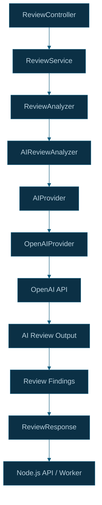

# CodeSentinel AI — AI Analysis Implementation

## 1. Overview

CodeSentinel AI uses a Java Spring Boot review service to coordinate AI-powered code reviews.

The review service separates review orchestration from AI-provider communication through analyzer and provider abstractions.

The primary components are:

- `ReviewService`
- `ReviewAnalyzer`
- `AIReviewAnalyzer`
- `AIProvider`
- `OpenAIProvider`

This separation makes the review workflow easier to test and provides a boundary between application logic and the external AI service.

## 2. AI Analysis Architecture

The diagram represents the logical review flow. The precise request and response mapping should follow the current DTOs and service implementation.

## 3. Component Responsibilities

### 3.1 ReviewController

`ReviewController` exposes the review REST endpoint:

`POST /api/v1/reviews`

It accepts a review request, validates it, and delegates processing to `ReviewService`.

### 3.2 ReviewService

`ReviewService` coordinates the review lifecycle.

Its responsibilities include:

- Checking for an existing review.
- Creating or updating review state.
- Invoking the configured analyzer.
- Persisting review outcomes.
- Returning the review response.
- Recording failed processing attempts.

The service also implements basic idempotency using repository, pull request number, and commit SHA.

### 3.3 ReviewAnalyzer

`ReviewAnalyzer` defines the contract for review analysis.

It allows the review service to depend on an abstraction instead of being tightly coupled to a specific analyzer implementation.

### 3.4 AIReviewAnalyzer

`AIReviewAnalyzer` implements AI-powered review analysis.

It coordinates the AI review operation and integrates with the configured AI provider through `AIProvider`.

### 3.5 AIProvider

`AIProvider` abstracts communication with the AI service.

This separates AI-provider integration from the review lifecycle and allows provider behavior to be tested independently.

### 3.6 OpenAIProvider

`OpenAIProvider` implements the provider integration with the OpenAI API.

It uses the configured OpenAI credentials and communicates with the external AI service to obtain review output.

The API key should be supplied through environment configuration rather than hardcoded in source code.

## 4. Request Processing Flow

1. The Node.js API prepares the pull request review input.
2. The Java `ReviewController` receives the request.
3. The controller validates the request and calls `ReviewService`.
4. `ReviewService` checks the existing review state.
5. For a new review or an eligible retry, the service invokes `ReviewAnalyzer`.
6. `AIReviewAnalyzer` performs the AI review using `AIProvider`.
7. `OpenAIProvider` communicates with the OpenAI API.
8. The analyzer returns the review output to the service.
9. The service persists the outcome in PostgreSQL.
10. The service returns a `ReviewResponse` to the caller.

A completed review for the same repository, pull request, and commit can be reused rather than invoking AI analysis again.

## 5. Review Input and Output

The review input contains pull request metadata and changed-file information, including file patches where available.

The Java service uses request and response DTOs to define its API contract.

Relevant DTOs include:

- `ReviewRequest`
- `PullRequestInput`
- `ReviewFileInput`
- `AIReviewOutput`
- `ReviewFinding`
- `ReviewResponse`

The exact fields and validation rules are defined by the DTO implementations in the Java service.

AI-generated findings are subsequently consumed by the Node.js review integration, where findings are mapped to valid changed lines before GitHub inline comments are published.

## 6. Error Handling

AI review processing depends on an external provider and can fail independently of database operations.

Potential failure areas include:

- Provider authentication errors.
- Network timeouts.
- Rate limits.
- Invalid or unexpected AI responses.
- Provider service errors.
- Review output validation failures.

The Java service records a failed review state when analysis throws a runtime exception and propagates the failure.

The exact retry behavior depends on the calling workflow. Once asynchronous processing is fully integrated, BullMQ can provide job-level retries for eligible failures.

Provider errors should be logged without exposing API keys, sensitive review payloads, or entire source patches.

## 7. Testing Considerations

AI integration should be tested at multiple levels.

### Unit tests

Test the review service and analyzer using controlled test doubles for external dependencies.

### Provider tests

Verify request construction, response parsing, and provider error handling. Tests should avoid making real API calls unless explicitly configured as integration tests.

### Controller tests

Verify request validation, response handling, and error mapping at the REST boundary.

### Integration tests

Verify the complete review path using controlled provider responses and a test database where appropriate.

### End-to-end tests

Verify the complete GitHub-to-AI-to-inline-comment flow after queue integration is available.

## 8. Security Considerations

- Load the OpenAI API key from environment configuration.
- Never commit credentials to source control.
- Avoid logging complete source patches or sensitive AI request payloads.
- Validate AI output before using it to construct GitHub comments.
- Treat AI findings as recommendations that require correct mapping to the actual Pull Request diff.

## 9. Related Source Files

Located under:

`apps/review-service/src/main/java/com/codesentinel/review/`

- `controller/ReviewController.java`
- `service/ReviewService.java`
- `analyzer/ReviewAnalyzer.java`
- `analyzer/AIReviewAnalyzer.java`
- `ai/AIProvider.java`
- `ai/OpenAIProvider.java`
- `ai/AIReviewOutput.java`
- `exception/GlobalExceptionHandler.java`

Related Node.js files:

- `apps/api/src/services/review/reviewServiceClient.ts`
- `apps/api/src/services/review/reviewInputService.ts`
- `apps/api/src/services/review/reviewFindingMapper.ts`

## 10. Implementation Status

The Java review service, analyzer abstraction, AI provider integration, and review persistence are part of the current implementation.

The asynchronous BullMQ worker integration is still subject to end-to-end verification.

Provider-specific behavior, validation rules, and output fields should be kept synchronized with the actual source code as the implementation evolves.

## 11. Related Documentation

- [System Architecture](../architecture/system-architecture.md)
- [Review Processing](../architecture/review-processing.md)
- [Review Lifecycle](../architecture/review-lifecycle.md)
- [Review Input](review-input.md)
- [Redis and BullMQ](redis-bullmq.md)
- [Testing](testing.md)
- [Architecture Decisions](../decisions/architecture-decisions.md)
