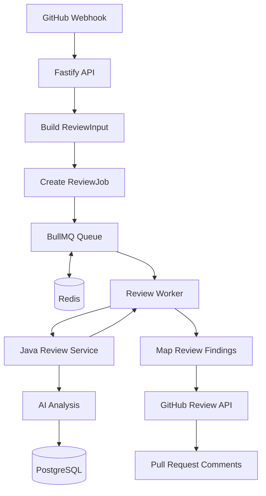

# CodeSentinel AI — Redis and BullMQ Implementation

## 1. Overview

CodeSentinel AI is introducing BullMQ and Redis to process GitHub Pull Request reviews asynchronously.

The intended design separates webhook handling from review execution. The Node.js API prepares review jobs, BullMQ manages the queue, Redis stores queue data, and a Node.js worker processes jobs by calling the Java Spring Boot review service.

The asynchronous integration is being developed incrementally. Redis connectivity and package installation have been verified, but the complete queue-to-worker-to-GitHub flow must be tested before it is considered fully implemented.

## 2. Architecture



The diagram shows the target asynchronous workflow rather than a claim that every integration step has already been verified.

## 3. Technology and Dependencies

The Node.js API uses:

- `bullmq` for queue and worker processing.
- `ioredis` for Redis connectivity.
- TypeScript for typed job payloads.

Redis runs locally through the reusable Docker Compose infrastructure.

The Java review service remains responsible for review orchestration, AI analysis, and persistence.

## 4. Redis Connection

Source file:

`apps/api/src/queues/redis.ts`

The Redis connection is shared by the queue and worker.

The intended local connection URL is:

`redis://localhost:6379`

The connection configuration uses the Redis host and port parsed from the configured URL. BullMQ workers require a compatible Redis connection configuration, including `maxRetriesPerRequest: null` for the shared ioredis connection used by the worker.

The Node.js application's environment configuration must expose the Redis URL through `REDIS_URL`.

The infrastructure `.env` file is not automatically loaded into an independently launched Node.js application.

### Verify Redis connectivity

Start the infrastructure from the `dev-infrastructure` directory:

```bash
docker compose up -d redis
```

Check the Redis connection:

```bash
docker exec -it dev-redis redis-cli ping
```

Expected output:

```text
PONG
```

This confirms Redis connectivity, but does not by itself prove that BullMQ jobs can be enqueued and processed successfully.

## 5. Review Job Payload

Source file:

`apps/api/src/queues/reviewJob.ts`

The review job carries the GitHub installation context and the normalized review input.

```ts
import type { ReviewInput } from "../services/review/reviewInputService.js";

export interface ReviewJob {
  installationId: number;
  owner: string;
  repo: string;
  reviewInput: ReviewInput;
}
```

### Payload responsibilities

| Field            | Purpose                                                               |
| ---------------- | --------------------------------------------------------------------- |
| `installationId` | Identifies the GitHub App installation used for repository operations |
| `owner`          | Repository owner                                                      |
| `repo`           | Repository name                                                       |
| `reviewInput`    | Pull Request metadata and changed-file patches                        |

The payload should contain the information required to process the job independently of the original webhook request.

Avoid adding secrets or unnecessary sensitive information to queued job data.

## 6. Review Queue

Source file:

`apps/api/src/queues/reviewQueue.ts`

The queue is named:

`code-review`

The proposed configuration includes:

```ts
{
  attempts: 3,
  backoff: {
    type: "exponential",
    delay: 5000
  },
  removeOnComplete: 100,
  removeOnFail: 500
}
```

### Configuration behavior

- `attempts: 3` allows up to three processing attempts, including the initial attempt.
- Exponential backoff increases the delay between retries.
- `removeOnComplete: 100` retains a limited number of completed jobs.
- `removeOnFail: 500` retains a limited number of failed jobs.

Retention limits help avoid unbounded accumulation of completed and failed job records. They are not a replacement for application logging or operational monitoring.

## 7. Review Worker

Source file:

`apps/api/src/queues/reviewWorker.ts`

The worker is responsible for processing queued review jobs.

Its intended processing sequence is:

1. Read the job payload.
2. Call the Java review service.
3. Receive the review response.
4. Map findings to valid changed lines.
5. Submit valid inline comments to GitHub.
6. Return processing metrics.
7. Log job completion or failure.

The worker should log job identifiers and useful operational metadata without logging entire source patches, credentials, or sensitive review payloads.

### Worker lifecycle

The worker should support graceful shutdown by closing the BullMQ worker and its Redis connection.

A production implementation should also handle startup failures, Redis connectivity problems, and termination signals safely.

## 8. Review Processing and Retries

BullMQ retries failed jobs according to the configured attempts and backoff policy.

A job may fail because of:

- Redis connectivity problems.
- Java review-service errors.
- AI-provider failures.
- GitHub authentication or permission errors.
- GitHub API rate limits.
- Network timeouts.

Retrying every failure indefinitely is not appropriate. Retry behavior should account for whether a failure is transient or permanent.

### Duplicate processing

Jobs can be processed more than once because of retries, duplicate webhook deliveries, or interruptions during processing.

The Java service's review identity uses repository, Pull Request number, and commit SHA to support reuse of completed review results.

However, database idempotency alone does not prevent duplicate GitHub comments.

A worker may successfully publish comments but fail before BullMQ records the job as completed. A retry could then publish them again.

This behavior requires explicit testing and a reliable comment-publication strategy.

## 9. Webhook Integration

The intended integration changes the webhook flow from synchronous processing to asynchronous job submission.

### Target behavior

1. Validate the webhook signature.
2. Process supported Pull Request actions.
3. Retrieve Pull Request metadata and changed files.
4. Build the normalized review input.
5. Enqueue the job.
6. Return HTTP `202 Accepted` after successful enqueueing.

A successful `202 Accepted` response means that the job was accepted for processing, not that the AI review has completed.

If enqueueing fails, the API must not report successful acceptance of a job that was not stored in the queue.

The webhook handler should be updated only after the queue can reliably accept and process jobs.

## 10. Configuration and Local Development

The local infrastructure is defined in:

`dev-infrastructure/docker-compose.yml`

Relevant services:

| Service    | Local port |
| ---------- | ---------: |
| Redis      |     `6379` |
| PostgreSQL |     `5432` |
| Adminer    |     `8080` |

Start the infrastructure:

```bash
cd /Users/tejasmudholkar/Developer/dev-infrastructure
docker compose up -d
```

Run Node.js commands from the API directory:

```bash
cd /Users/tejasmudholkar/Developer/ai-lab/codesentinel-ai/apps/api
```

If the `worker` script has been added to `apps/api/package.json`, the intended command is:

```bash
npm run worker
```

Verify the script exists before running it. Do not assume that a drafted worker file is already fully integrated.

## 11. Testing Checklist

Before marking the asynchronous pipeline as implemented, verify the following:

- [ ] Redis starts and accepts connections.
- [ ] The API can enqueue a typed review job.
- [ ] The queue persists jobs in Redis.
- [ ] The worker starts and consumes queued jobs.
- [ ] The worker calls the Java review service successfully.
- [ ] Valid findings are mapped to changed lines.
- [ ] GitHub comments are submitted successfully.
- [ ] Failed jobs follow the configured retry policy.
- [ ] Duplicate webhook events do not create unnecessary duplicate work.
- [ ] Retries do not cause duplicate GitHub comments.
- [ ] The webhook returns `202 Accepted` only after successful enqueueing.
- [ ] The worker shuts down cleanly.

## 12. Implementation Status

### Verified or configured

- Redis is available through the local Docker Compose infrastructure.
- The Node.js API has BullMQ and ioredis installed.
- Redis connectivity has been tested.
- The queue and worker implementation has been drafted.

### Requires verification

- Queue and worker compilation and startup.
- End-to-end job enqueueing and consumption.
- Webhook integration with asynchronous job submission.
- Correct HTTP `202 Accepted` behavior.
- Retry safety and duplicate-comment prevention.
- Graceful shutdown and failure recovery.

Update this section as the corresponding tests pass and implementation work is completed.

## 13. Related Documentation

- [System Architecture](../architecture/system-architecture.md)
- [Asynchronous Review Queue](../architecture/async-review-queue.md)
- [Infrastructure](../architecture/infrastructure.md)
- [Deployment Architecture](../architecture/deployment-architecture.md)
- [Review Input](review-input.md)
- [AI Analysis](ai-analysis.md)
- [Testing](testing.md)
- [Architecture Decisions](../decisions/architecture-decisions.md)
