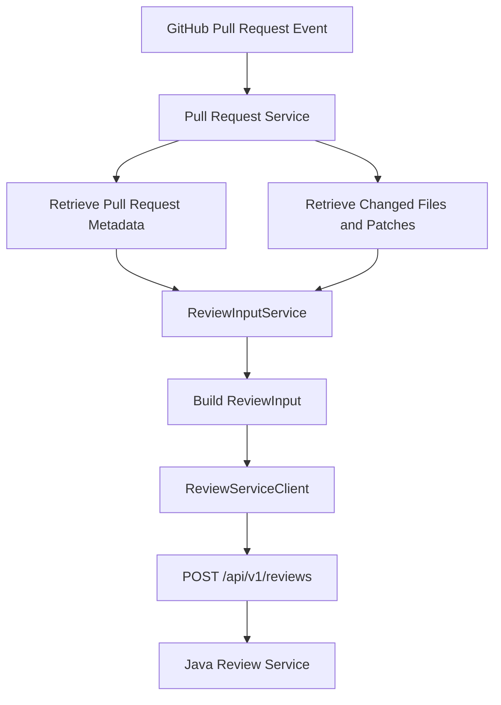

# CodeSentinel AI — Review Input Implementation

## 1. Overview

CodeSentinel AI prepares a normalized review input from GitHub Pull Request metadata and changed-file information.

The Node.js API retrieves the Pull Request details and changed files, then uses `ReviewInputService` to build the input consumed by the Java Spring Boot review service.

The normalized input separates GitHub data retrieval from review processing and provides a consistent request structure for the AI review workflow.

## 2. Review Input Flow



## 3. Main Components

### 3.1 Pull Request Service

The Pull Request service retrieves the Pull Request metadata and changed-file information through the GitHub integration.

The metadata identifies the Pull Request and its head commit. Changed-file information provides the context needed to map AI findings back to the proposed code changes.

### 3.2 ReviewInputService

Source file:

`apps/api/src/services/review/reviewInputService.ts`

The service builds a normalized `ReviewInput` from the retrieved GitHub information.

Its responsibilities include:

- Representing Pull Request metadata in a consistent structure.
- Mapping changed-file metadata.
- Including file patches where available.
- Filtering files that do not contain a patch.

### 3.3 ReviewServiceClient

Source file:

`apps/api/src/services/review/reviewServiceClient.ts`

The client sends the normalized review input to the Java service through:

`POST /api/v1/reviews`

It handles unsuccessful HTTP responses by reporting the request failure to its caller.

## 4. ReviewInput Structure

The current TypeScript interface is:

```ts
export interface ReviewInputFile {
  filename: string;
  status: string;
  additions: number;
  deletions: number;
  changes: number;
  patch: string;
}

export interface ReviewInput {
  pullRequest: {
    repository: string;
    number: number;
    title: string;
    description: string | null;
    baseBranch: string;
    headBranch: string;
    headSha: string;
    url: string;
  };
  files: ReviewInputFile[];
}
```

### Pull Request metadata

| Field         | Description                                        |
| ------------- | -------------------------------------------------- |
| `repository`  | Repository identifier used by the review workflow  |
| `number`      | Pull Request number                                |
| `title`       | Pull Request title                                 |
| `description` | Pull Request description, or `null` if unavailable |
| `baseBranch`  | Target branch                                      |
| `headBranch`  | Source branch                                      |
| `headSha`     | Commit SHA identifying the reviewed head           |
| `url`         | Pull Request URL                                   |

### Changed-file metadata

| Field       | Description                                        |
| ----------- | -------------------------------------------------- |
| `filename`  | File path                                          |
| `status`    | GitHub-provided changed-file status                |
| `additions` | Number of added lines                              |
| `deletions` | Number of deleted lines                            |
| `changes`   | Total changed lines as provided by the source data |
| `patch`     | Available patch text for the changed file          |

The interface uses TypeScript types to make the expected request structure explicit.

## 5. Patch Availability

The review input builder filters out files that do not contain a patch.

This is important because inline review comments need to be mapped to actual changed lines in the Pull Request diff.

A file without an available patch cannot be processed using the same line-mapping approach as a file with a patch.

Consequently, the files sent for review may be a subset of all files returned by GitHub.

## 6. Head Commit and Review Identity

The `headSha` field identifies the Pull Request commit being reviewed.

The Java review service uses repository identity, Pull Request number, and commit SHA to distinguish review records.

A subsequent commit pushed to the same Pull Request can therefore represent a different review.

The worker also uses the reviewed head commit when submitting GitHub inline review comments.

## 7. Review Input and Finding Mapping

The review input serves two purposes:

1. It supplies the Java review service with Pull Request context and changed-file patches.
2. It preserves the file and commit context needed to validate the returned findings.

After the Java service returns its review response, `ReviewFindingMapper` uses the original changed-file information to map findings to valid changed lines.

Findings that cannot be mapped to valid changed lines are skipped.

## 8. Error Handling and Limitations

### Missing patches

Files without patches are excluded by the current input-building logic.

### Large Pull Requests

Large Pull Requests may contain many changed files or extensive patches. Review-size limits, chunking, and token-budget strategies should be documented and implemented according to the project's actual requirements.

### Incomplete GitHub data

The review input builder should handle optional Pull Request descriptions and any missing patch data according to the existing implementation.

### Commit changes during processing

The `headSha` associates the review with the commit captured during input preparation. The processing flow should account for a newer commit appearing while an earlier review is still running.

## 9. Related Source Files

### Node.js API

- `apps/api/src/services/review/reviewInputService.ts`
- `apps/api/src/services/review/reviewServiceClient.ts`
- `apps/api/src/services/review/reviewFindingMapper.ts`
- `apps/api/src/services/github/pullRequestService.ts`

### Java Review Service

- `apps/review-service/src/main/java/com/codesentinel/review/controller/ReviewController.java`
- `apps/review-service/src/main/java/com/codesentinel/review/service/ReviewService.java`

## 10. Implementation Status

The normalized review input interface, input-building service, Java review-service client, and changed-line finding mapper are part of the current implementation.

The exact behavior for large Pull Requests, unavailable patches, and Pull Request updates during processing should be verified against the current code and tests.

The asynchronous queue integration remains subject to end-to-end verification.

## 11. Related Documentation

- [System Architecture](../architecture/system-architecture.md)
- [GitHub Integration](../architecture/github-integration.md)
- [Review Processing](../architecture/review-processing.md)
- [Inline Review Comments](../architecture/inline-review-comments.md)
- [AI Analysis](ai-analysis.md)
- [Redis and BullMQ](redis-bullmq.md)
- [Testing](testing.md)
