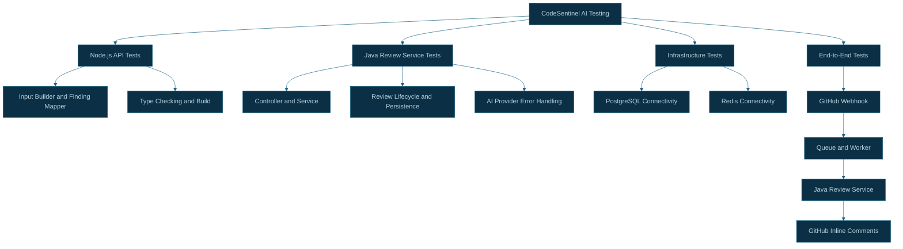

# CodeSentinel AI — Testing Strategy and Verification

## 1. Overview

CodeSentinel AI contains a Node.js API and a Java Spring Boot review service. Both require testing at their individual component boundaries and across their integration points.

The testing strategy covers:

- Node.js unit tests and type checking.
- Java unit and controller tests.
- Review input construction and finding mapping.
- Review lifecycle and persistence.
- Redis and BullMQ connectivity.
- End-to-end GitHub review processing.

Tests that require external services or credentials should be run separately from ordinary unit tests.

## 2. Testing Architecture



## 3. Node.js API Tests

### Location

`apps/api/`

The Node.js test suite uses Vitest.

### Run the tests

```bash
cd /Users/tejasmudholkar/Developer/ai-lab/codesentinel-ai/apps/api

npm test
```

### Type-check the project

```bash
npm run typecheck
```

### Build the project

```bash
npm run build
```

### Areas to test

- Review input construction.
- Handling of missing patches.
- Finding-to-diff-line mapping.
- Skipping findings that cannot be mapped to changed lines.
- Review service HTTP failures.
- Queue job construction and enqueue failures.
- Worker error handling and retries.

The exact test coverage depends on the tests currently present in the repository.

## 4. Java Review Service Tests

### Location

`apps/review-service/`

The Java service uses Maven and Spring Boot testing support.

### Run the tests

```bash
cd /Users/tejasmudholkar/Developer/ai-lab/codesentinel-ai/apps/review-service

./mvnw test
```

### Build the project

```bash
./mvnw package
```

### Areas to test

- Controller request validation.
- Review service orchestration.
- Existing completed review handling.
- In-progress review behavior.
- Retry behavior for failed reviews.
- Persistence and unique review identity.
- AI analyzer behavior using controlled test doubles.
- Error handling and failed-state persistence.

Tests should avoid requiring real OpenAI API calls unless explicitly configured as integration tests.

## 5. Review Input and Finding Mapper Tests

The Node.js API contains separate components for preparing review input and mapping review findings.

### Review input tests

Verify that:

- Pull Request metadata is represented correctly.
- Changed-file metadata is preserved.
- Files without patches are filtered out.
- The head commit SHA is carried through the review workflow.

### Finding mapper tests

Verify that:

- Valid changed lines produce inline comments.
- Findings on unchanged lines are skipped.
- Findings for files outside the supplied review input are skipped.
- Invalid line references do not generate GitHub comments.
- The number of skipped findings is reported correctly.

## 6. Persistence and Idempotency Tests

The Java service uses PostgreSQL to track review records.

Tests should verify the behavior of the review identity:

`repository + pull_request_number + commit_sha`

Important scenarios include:

| Scenario                          | Expected behavior                    |
| --------------------------------- | ------------------------------------ |
| First review request              | Create a review and start processing |
| Repeated completed request        | Reuse the stored result              |
| Request for an in-progress review | Return the current state             |

| Retry
